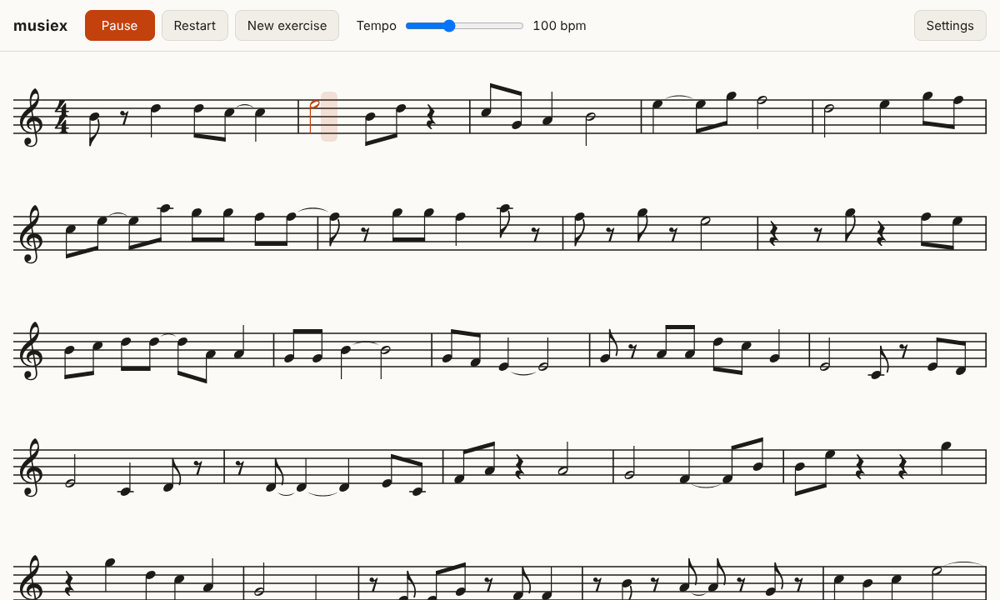
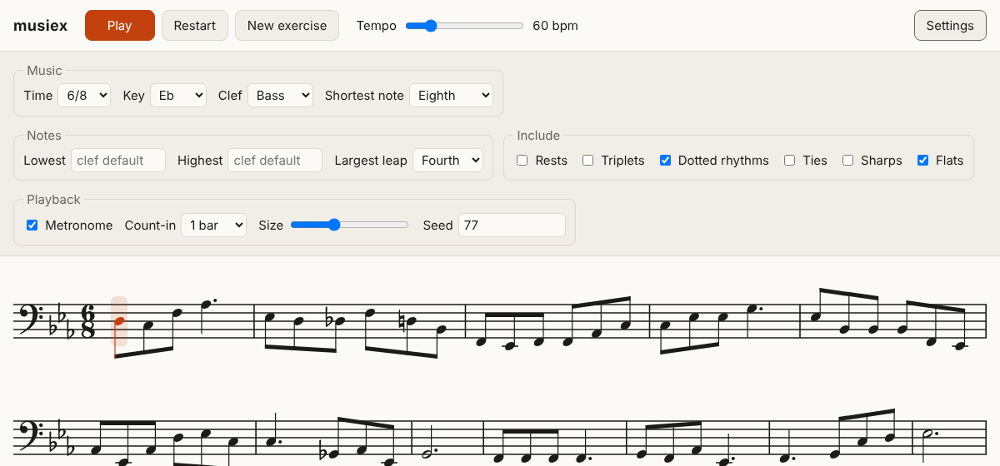
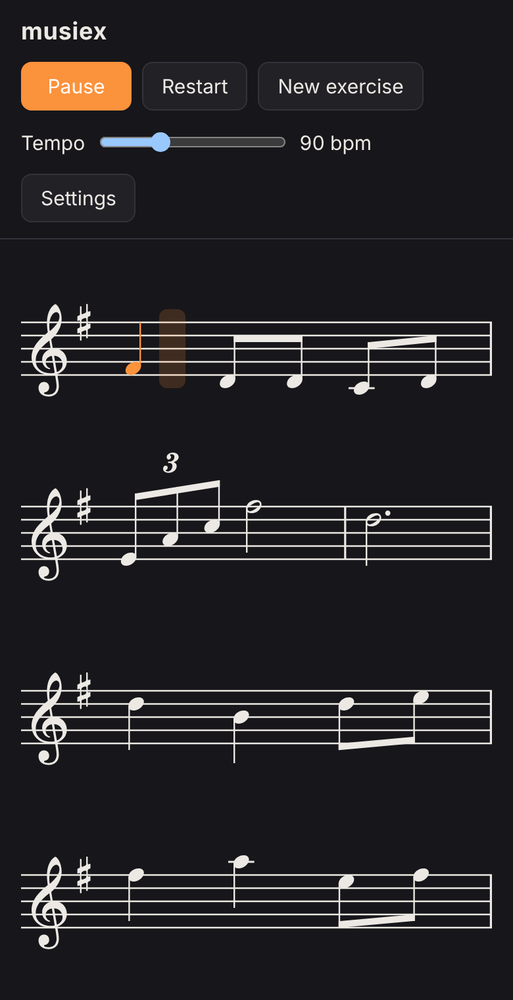
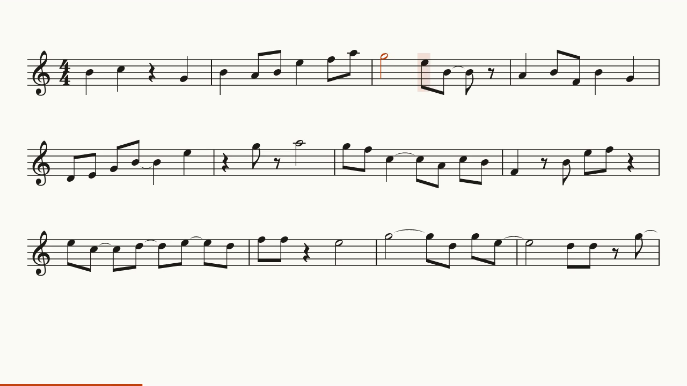

# musiex

**Endless sight-reading exercises that play themselves.** Pick a meter, key,
clef and difficulty, press Play, and read along: musiex writes new bars as
you go, plays them, and shows you where you are.



musiex is a clean rewrite of [ABCMusiEx](https://github.com/rodolfoap/abcmusiex)
in Rust. The original wrote a fixed number of bars to PDF and audio files;
musiex keeps the same idea (random, readable, musically sensible exercises)
and adds a practice screen that never runs out of music.

## Features

- **Practice screen in the browser.** The current note lights up, a cursor
  moves with the music, finished lines scroll away, and new bars appear
  without limit. Everything runs locally in WebAssembly; there is no server.
- **All controls on one screen.** Play, pause, restart, a new exercise, and a
  tempo slider that works while playing. Space plays and pauses, N starts a
  new exercise.
- **Shareable exercises.** Settings and seed live in the link, so the same
  link always gives the same music.
- **Real engraving.** A small engraver written for musiex draws noteheads,
  beams, ties, tuplets, rests, accidentals, clefs, key and time signatures
  with the [Bravura](https://github.com/steinbergmedia/bravura) music font.
- **Musical rules, not noise.** Rhythms follow the beat structure of simple
  and compound meters (6/8 feels like two, 7/8 groups as 3+4), melodies move
  in a bounded walk with a limit on leaps, accidentals respect the key, and
  ties only land where a reader expects them.
- **Command line tool.** Write ABC notation, MIDI with a metronome track,
  WAV audio, or an MP4 video of the scrolling score.

<table>
<tr>
<td width="62%"></td>
<td></td>
</tr>
<tr>
<td>Settings: meter, key, clef, range, rhythms and playback.</td>
<td>On a phone, in dark mode.</td>
</tr>
</table>

## Practice screen

```sh
rustup target add wasm32-unknown-unknown
cargo install wasm-bindgen-cli --version 0.2.129
./web/build.sh
python3 -m http.server -d web 8000   # then open http://localhost:8000
```

The page is static: `web/` (with the generated `web/pkg/`) can be served
from any web host.

| Setting | Choices |
| --- | --- |
| Time | 2/4, 3/4, 4/4, 5/4, 2/2, 3/8, 6/8, 9/8, 12/8, 7/8 |
| Key | 12 major and 9 minor keys, from six sharps to five flats |
| Clef | treble, bass, alto, tenor |
| Shortest note | half, quarter, eighth, sixteenth |
| Range | lowest and highest note, or a comfortable default for the clef |
| Largest leap | from a step up to an octave |
| Include | rests, triplets, dotted rhythms, ties, sharps, flats |
| Playback | metronome, count-in, score size, seed |

## Command line

```sh
cargo install --path crates/musiex-cli   # installs the `musiex` command
musiex generate --help
musiex video --help
```

### Scores, MIDI and audio

```sh
# 32 bars in G major, eighth notes, with rests and triplets
musiex generate -k G -l 3 --rests --triplets -o lesson1

# 6/8 in the bass clef, reproducible, with a WAV file
musiex generate -m 6/8 -c bass -k Dm -l 3 --ties -s 1234 --wav
```

The first command writes `lesson1.abc` and `lesson1.mid`; `--wav` adds a
WAV file, rendered with the built-in synth or, with `--soundfont FILE.sf2`,
any General MIDI SoundFont. Any ABC tool can print the score, for example
[abcjs](https://www.abcjs.net/abcjs-editor.html) in the browser or `abcm2ps`.

### Video

```sh
# 16 bars at 90 bpm as a 1280x720 MP4, with a one-bar count-in
musiex video -n 16 -t 90 -l 3 --rests --ties -o lesson1.mp4
```



The video shows the same score as the practice screen, with the same synth
for the sound and a progress bar along the bottom. `--size`, `--fps` and
`--zoom` set the frame size, frame rate and score size. It needs `ffmpeg` on
the `PATH`, or `--ffmpeg PATH`.

### Options

| Option | Meaning | Default |
| --- | --- | --- |
| `-n`, `--bars` | number of bars | 32 (`video`: 16) |
| `-t`, `--tempo` | beats per minute; in 6/8 the beat is a dotted quarter | 60 |
| `-m`, `--meter` | time signature | 4/4 |
| `-k`, `--key` | key, e.g. `C`, `Bb`, `F#m` | C |
| `-c`, `--clef` | treble, bass, alto or tenor | treble |
| `-r`, `--range` | note range, e.g. `C4..A5` | depends on the clef |
| `-l`, `--level` | shortest note: 1 half, 2 quarter, 3 eighth, 4 sixteenth | 2 |
| `-d`, `--leap` | largest leap in staff steps (2 is a third) | 3 |
| `--rests` `--triplets` `--dotted` `--ties` `--sharps` `--flats` | figures to include | off |
| `-s`, `--seed` | seed for a reproducible exercise | random, printed |
| `--count-in` | bars of metronome before the music | 1 |
| `--no-metronome` | leave out the click | |

Coming from ABCMusiEx: the old "dispersion" is `--leap`, `--legato` still
works as an alias for `--ties`, and the range is now given as note names.

## How it works

```
crates/
  musiex-core      music model and generator, no I/O
  musiex-audio     tick-based sequencer, built-in synth, SoundFont playback
  musiex-engrave   SVG engraving with Bravura glyphs
  musiex-web       the practice screen's WebAssembly core
  musiex-cli       the musiex command
web/               the practice page around the WebAssembly core
tools/             glyph extraction, ABC and browser checks
```

- **Generator** (`musiex-core`): an endless iterator of bars. Rhythm comes
  from recursive subdivision of each beat group; melody is a bounded random
  walk over staff positions. A tiny in-tree PCG random number generator keeps
  every seed stable across platforms and releases.
- **Audio** (`musiex-audio`): a sequencer that renders block by block and
  accepts tempo changes while playing, with a dependency-free synth and
  SoundFont playback through rustysynth.
- **Engraver** (`musiex-engrave`): lays out one system at a time, packing as
  many bars as fit at natural spacing, and reports where each note sits so
  the screen and the video can follow playback.
- **Practice screen** (`musiex-web`, `web/`): asks the core for one system at
  a time just ahead of the music, and schedules audio on the Web Audio clock
  so sound and picture stay together.
- **Video** (`musiex-cli`): rasterizes the engraved systems with resvg and
  pipes frames to ffmpeg alongside the synthesized audio.

## Development

```sh
cargo test
cargo clippy --all-targets -- -D warnings
```

`tests/golden` pins the output of a few seeds. If a change to the generator is
intended, refresh them with `UPDATE_GOLDEN=1 cargo test -p musiex-core --test golden`.

CI also generates 200 exercises across meters, keys and levels and checks them
with abcjs (`tools/check-abc.js`), plays the practice screen in headless
Chromium (`tools/web-smoke.js`), and renders a short video with ffmpeg.

`cargo run -p musiex-engrave --example svg > page.html` prints a page of
engraved systems in several meters, keys and clefs, for checking the layout
by eye.

To refresh the screenshots in `docs/images`, serve `web/` and take them from
the browser; the video frame comes from `musiex video` and
`ffmpeg -ss 9.3 -i video.mp4 -frames:v 1 frame.png`.

## License

GPL-3.0-or-later, like the original. The Bravura music font is © Steinberg
Media Technologies GmbH under the SIL Open Font License 1.1
(`crates/musiex-engrave/BRAVURA-OFL.txt`).
